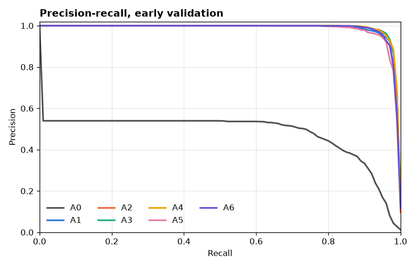
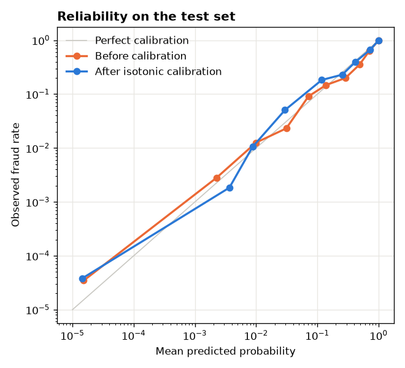

# FraudLens model report

Generated by `python -m fraudlens.training report` from the JSON artefacts in this directory and in the model bundle. Intervals are 95% day-block bootstrap intervals.

> **Simulated data.** Sparkov is generated data; these numbers show method, not real-world accuracy.

## Imbalance study

Seven arms, 5 seeds each, trained on 960,514 rows (5,460 frauds) and evaluated on the early validation slice: 194,501 rows, 1,151 frauds. Each value is the mean over seeds. Brier scores are on the arm's own probabilities, before any calibration.

| Arm | Setup | Average precision | Recall @ 1% | Dollar recall @ 1% | Precision @ 1% | Brier | ROC-AUC |
| --- | --- | --- | --- | --- | --- | --- | --- |
| A0 | Logistic regression, balanced class weights | 0.436 [0.393, 0.495] | 0.695 [0.649, 0.738] | 0.824 [0.779, 0.862] | 0.401 [0.363, 0.452] | 0.03288 [0.03187, 0.03371] | 0.9904 |
| A1 | XGBoost, no weighting | 0.987 [0.982, 0.992] | 0.890 [0.829, 0.947] | 0.914 [0.859, 0.963] | 0.514 [0.469, 0.583] | 0.00045 [0.00036, 0.00056] | 0.9998 |
| A2 | XGBoost, scale_pos_weight = negatives / positives | 0.989 [0.985, 0.994] | 0.891 [0.830, 0.948] | 0.915 [0.863, 0.963] | 0.514 [0.469, 0.584] | 0.00052 [0.00045, 0.00061] | 0.9998 |
| A3 | XGBoost, scale_pos_weight = sqrt(negatives / positives) | 0.990 [0.985, 0.995] | 0.891 [0.830, 0.948] | 0.914 [0.859, 0.963] | 0.515 [0.470, 0.584] | 0.00039 [0.00032, 0.00048] | 0.9999 |
| A4 | XGBoost, no weighting, max_delta_step = 1 | 0.989 [0.984, 0.994] | 0.890 [0.830, 0.947] | 0.911 [0.855, 0.960] | 0.514 [0.469, 0.583] | 0.00039 [0.00030, 0.00048] | 0.9999 |
| A5 | XGBoost, undersample negatives to 1:10, then prior correction | 0.983 [0.978, 0.989] | 0.887 [0.828, 0.945] | 0.914 [0.860, 0.961] | 0.512 [0.468, 0.580] | 0.00050 [0.00041, 0.00060] | 0.9998 |
| A6 | XGBoost, SMOTE inside the training fold up to 0.1 frauds per genuine row | 0.986 [0.980, 0.991] | 0.888 [0.828, 0.945] | 0.916 [0.865, 0.962] | 0.513 [0.469, 0.581] | 0.00043 [0.00033, 0.00053] | 0.9998 |



## Tuning

Arm A3, 40 Optuna trials, objective: mean average precision over prequential folds. Best value: 0.9828.

```json
{
  "colsample_bytree": 0.6836402902846812,
  "gamma": 0.2667111090298725,
  "learning_rate": 0.09395395145220313,
  "max_depth": 6,
  "min_child_weight": 2.829842382600611,
  "reg_lambda": 0.9416680608855234,
  "subsample": 0.9550427295441364
}
```

## Release 2026-11-17.1

Arm A3, 398 trees, git commit `089e8dcbcc6d`.

- Thresholds, chosen on the late validation slice: review at 0.0200, block at 0.9333.
- Brier score on the late validation slice: 0.00040 raw, 0.00037 calibrated (in-sample for the calibrator).

## Final test

Scored once: 555,719 transactions over 194 days, 2,145 frauds.

| Metric | Value |
| --- | --- |
| Average precision | 0.974 [0.967, 0.980] |
| Recall @ 0.5% daily budget | 0.768 [0.718, 0.816] |
| Recall @ 1% daily budget | 0.944 [0.918, 0.965] |
| Dollar recall @ 1% daily budget | 0.966 [0.947, 0.982] |
| Precision @ 1% daily budget | 0.358 [0.319, 0.402] |
| ROC-AUC (reported, not optimised) | 0.9994 |
| Brier score, raw / calibrated | 0.00040 / 0.00039 |
| Expected cost per 1,000 transactions | $27.68 |
| Cost per 1,000 if everything were approved | $2039.38 |



### Review queue order

| Budget | Ordering | Recall | Dollar recall | Precision |
| --- | --- | --- | --- | --- |
| 0.5pct | rank by score | 0.765 | 0.781 | 0.570 |
| 0.5pct | rank by score times amount | 0.725 | 0.912 | 0.541 |
| 1pct | rank by score | 0.944 | 0.963 | 0.358 |
| 1pct | rank by score times amount | 0.918 | 0.991 | 0.349 |

### Fairness check

False-positive rate of any flag (review or block) among genuine transactions. The model never sees gender; age enters only as a feature.

| Group | Genuine rows | False-positive rate | Recall |
| --- | --- | --- | --- |
| F | 303,722 | 0.2772% | 0.970 |
| M | 249,852 | 0.1921% | 0.985 |
| under 25 | 46,214 | 0.2510% | 1.000 |
| 25-39 | 174,632 | 0.2932% | 0.983 |
| 40-54 | 173,880 | 0.2461% | 0.962 |
| 55-69 | 96,890 | 0.1920% | 0.976 |
| 70 and over | 61,958 | 0.1291% | 0.983 |

## ULB benchmark

The same harness on the ULB dataset: 213,605 training rows, 71,202 evaluation rows (94 frauds), split by time. Budgets are per hour.

| Arm | Setup | Average precision | Recall @ 1% | Dollar recall @ 1% | Precision @ 1% | Brier | ROC-AUC |
| --- | --- | --- | --- | --- | --- | --- | --- |
| A1 | XGBoost, no weighting | 0.763 [0.654, 0.836] | 0.851 [0.775, 0.915] | 0.846 [0.699, 0.993] | 0.112 [0.078, 0.143] | 0.00047 [0.00037, 0.00059] | 0.9837 |
| A2 | XGBoost, scale_pos_weight = negatives / positives | 0.797 [0.714, 0.863] | 0.874 [0.800, 0.933] | 0.874 [0.757, 0.994] | 0.115 [0.079, 0.147] | 0.00055 [0.00044, 0.00071] | 0.9801 |
| A3 | XGBoost, scale_pos_weight = sqrt(negatives / positives) | 0.807 [0.718, 0.872] | 0.881 [0.825, 0.937] | 0.868 [0.743, 0.994] | 0.115 [0.080, 0.148] | 0.00042 [0.00032, 0.00058] | 0.9834 |
| A4 | XGBoost, no weighting, max_delta_step = 1 | 0.802 [0.712, 0.864] | 0.864 [0.795, 0.920] | 0.854 [0.714, 0.993] | 0.113 [0.079, 0.145] | 0.00039 [0.00029, 0.00050] | 0.9807 |
| A5 | XGBoost, undersample negatives to 1:10, then prior correction | 0.804 [0.713, 0.866] | 0.874 [0.816, 0.927] | 0.855 [0.739, 0.983] | 0.115 [0.080, 0.146] | 0.00051 [0.00040, 0.00061] | 0.9855 |
| A6 | XGBoost, SMOTE inside the training fold up to 0.1 frauds per genuine row | 0.810 [0.727, 0.871] | 0.862 [0.779, 0.923] | 0.873 [0.755, 0.993] | 0.113 [0.077, 0.147] | 0.00046 [0.00037, 0.00059] | 0.9801 |
